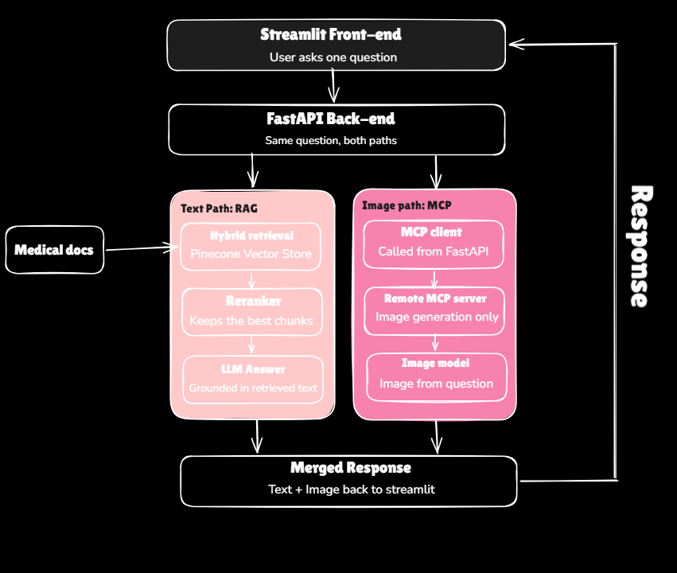

# MedExplain: Multimodal Medical Assistant

Ask one medical question and get a **plain-language answer grounded in medical documents** together with an **AI-generated educational illustration** of the same topic.


---

## Table of Contents

- [Overview](#overview)
- [Features](#features)
- [How It Works](#how-it-works)
- [Tech Stack](#tech-stack)
- [Project Structure](#project-structure)
- [Getting Started](#getting-started)
- [API Reference](#api-reference)
- [RAG Evaluation](#rag-evaluation)
- [Design Decisions](#design-decisions)
- [Troubleshooting](#troubleshooting)
- [Limitations and Disclaimer](#limitations-and-disclaimer)
- [Possible Improvements](#possible-improvements)
- [Author](#author)

---

## Overview

MedExplain is built for two groups of people:

- **Patients and families** who want conditions, tests and treatments explained in everyday language.
- **Students** who want a quick way to revise a topic and see it pictured.

The user types a single question. The system sends it down **two paths at the same time**:

| Path | What it does |
| --- | --- |
| **Text path (RAG)** | Searches a medical document collection, keeps the best passages and writes an answer using only those passages. |
| **Image path (MCP)** | A separate MCP server turns the same question into an educational illustration. |

Both results are merged and shown side by side in the web app.

<!-- Add a screenshot of the app here, for example:

-->

---

## Features

- **Grounded answers.** The language model answers only from retrieved document passages. If the documents do not cover the question, it says so instead of guessing.
- **Hybrid retrieval.** Semantic search (Pinecone) and keyword search (BM25) run together and their results are merged.
- **Reranking.** A reranker keeps only the passages that best match the question before the model sees them.
- **Text and image in one request.** The answer and the illustration are produced in parallel, so the wait is only as long as the slower of the two.
- **Graceful degradation.** If image generation fails, the written answer is still returned and the UI shows a short note.
- **MCP-based image service.** Image generation lives in its own Model Context Protocol server, so it can be hosted and replaced independently of the rest of the system.
- **Measured quality.** The RAG pipeline is evaluated with RAGAS.
- **Designed UI.** A Streamlit interface with a custom colour palette and a built-in "How it works" page.

---

## How It Works



1. **Ask.** The user enters a question in the Streamlit app.
2. **Send.** Streamlit posts the question to the FastAPI back-end (`POST /question`).
3. **Split.** FastAPI starts both paths at the same time with `asyncio.gather`.
4. **Text path.**
   - **Hybrid retrieval:** semantic search on the Pinecone vector store plus BM25 keyword search, merged into one list.
   - **Reranking:** the reranker keeps the best passages.
   - **Answer:** an LLM served by Groq writes the answer from those passages.
5. **Image path.**
   - The **MCP client** inside FastAPI calls the **remote MCP server** over streamable HTTP.
   - The server asks **FLUX.1 schnell on Cloudflare Workers AI** to draw an educational illustration for the question.
   - The picture comes back to FastAPI as a base64 image.
6. **Merge.** FastAPI returns `{ "answer": ..., "image_base64": ... }` and Streamlit shows both.

---

## Tech Stack

| Layer | Technology |
| --- | --- |
| Front-end | Streamlit (custom CSS, Bricolage Grotesque and Literata fonts) |
| Back-end | FastAPI, Uvicorn |
| Embeddings | Pinecone embeddings |
| Vector database | Pinecone |
| Keyword search | BM25 |
| Reranking | Reranker model |
| LLM | Groq |
| Image service | MCP Python SDK 2.x (`MCPServer`, streamable HTTP) |
| Image model | FLUX.1 schnell on Cloudflare Workers AI |
| Evaluation | RAGAS |
| Tooling | Python 3.12, uv |

---

## Project Structure

```text
.
├── app.py                      # Streamlit front-end
├── Back_End/
│   └── main.py                 # FastAPI app: runs the text and image paths together
├── RAG_Pipeline/
│   ├── Ingestion.py            # Loads documents, creates embeddings, fills Pinecone
│   ├── Retrieval.py            # Hybrid retrieval, reranking and the QA chain
│   ├── Generation.py           # Command-line test for the RAG chain
│   ├── ragas_data.py           # Evaluation questions and reference answers
│   └── Evalution(ragas).py     # RAGAS evaluation script
├── MCP_Pipeline/
│   ├── mcp_server.py           # MCP server: image generation only
│   └── mcp_client.py           # MCP client called from FastAPI
├── Data/                       # Source medical documents
├── docs/
│   └── Architecture.png        # Architecture diagram
├── .streamlit/
│   └── config.toml             # Streamlit theme (colour palette)
├── requirements.txt
└── .env                        # API keys (never commit this file)
```

---

## Getting Started

### Prerequisites

- Python 3.12
- [uv](https://docs.astral.sh/uv/) (or pip)
- A [Pinecone](https://www.pinecone.io/) account and API key
- A [Groq](https://console.groq.com/) API key
- A [Cloudflare](https://www.cloudflare.com/) account with Workers AI enabled, plus your **Account ID** and an **API token**

### 1. Clone and install

```bash
git clone https://github.com/<your-username>/<repo-name>.git
cd <repo-name>

uv venv
# Windows
.venv\Scripts\activate
# macOS / Linux
source .venv/bin/activate

uv pip install -r requirements.txt
```

If you use pip instead, run `python -m venv .venv`, activate it, then `pip install -r requirements.txt`.

### 2. Add your keys

Create a `.env` file in the project root:

```env
PINECONE_API_KEY=your_pinecone_key
GROQ_API_KEY=your_groq_key
CLOUDFLARE_ACCOUNT_ID=your_cloudflare_account_id
CLOUDFLARE_API_TOKEN=your_cloudflare_api_token

# Optional: where the MCP server runs (this is the default)
# MCP_SERVER_URL=http://127.0.0.1:8001/mcp
```

Never commit `.env`. Make sure it is listed in `.gitignore`.

### 3. Build the knowledge base (once)

Put your medical documents in `Data/`, then run the ingestion pipeline:

```bash
python RAG_Pipeline/Ingestion.py
```

### 4. Start the three services

Run each command from the project root, in its own terminal.

| Terminal | Command | Address |
| --- | --- | --- |
| 1. MCP image server | `python MCP_Pipeline/mcp_server.py` | http://127.0.0.1:8001/mcp |
| 2. FastAPI back-end | `uvicorn Back_End.main:app --reload` | http://127.0.0.1:8000/docs |
| 3. Streamlit front-end | `streamlit run app.py` | http://localhost:8501 |

The back-end builds its keyword index from the documents at startup, so it can take a minute before it is ready.

### 5. Check that everything works

- **Image service alone:** `python MCP_Pipeline/mcp_client.py "What are the symptoms of diabetes?"` saves `test_image.jpg`.
- **Back-end:** open http://127.0.0.1:8000/docs, run `POST /question`, and confirm both `answer` and `image_base64` are filled in.
- **Full app:** open http://localhost:8501 and ask a question.

---

## API Reference

### `POST /question`

**Request**

```json
{ "question": "What are the main functions of the skeletal system?" }
```

**Response**

```json
{
  "answer": "The main functions of the skeletal system are to: ...",
  "image_base64": "/9j/4AAQSkZJRgABAQ..."
}
```

| Field | Description |
| --- | --- |
| `answer` | Text answer written from the retrieved document passages. |
| `image_base64` | The illustration as a base64-encoded JPEG, or `null` if image generation failed. |

**Status codes**

| Code | Meaning |
| --- | --- |
| `200` | Success. `image_base64` may be `null` if only the image failed. |
| `422` | The request body is missing or invalid. |
| `500` | The RAG pipeline failed, so no answer could be produced. |

---

## RAG Evaluation

The retrieval and generation pipeline is evaluated with [RAGAS](https://docs.ragas.io/).

- The evaluation questions and reference answers are defined in `RAG_Pipeline/ragas_data.py`.
- Run the evaluation with:

```bash
python "RAG_Pipeline/Evalution(ragas).py"
```

<!-- Add your results here, for example a table of the RAGAS metrics you measured. -->

---

## Design Decisions

- **Two paths run in parallel.** The text and image paths are independent, so FastAPI runs them concurrently and the user waits only for the slower one.
- **The image path can fail without breaking the answer.** An image error is caught and turned into `image_base64: null`. Only a text failure returns an error.
- **Hybrid retrieval plus reranking.** Semantic search finds passages with the same meaning, and keyword search finds exact terms such as drug or disease names. The reranker then removes weak matches before generation.
- **The image service is a separate MCP server.** It does one job, can be hosted on its own, and can switch image providers without any change to the back-end.
- **Answers are restricted to retrieved text.** This reduces made-up answers in a domain where accuracy matters.

---

## Troubleshooting

| Problem | Likely cause and fix |
| --- | --- |
| The app says the back-end is not running | Start FastAPI with `uvicorn Back_End.main:app --reload` from the project root. |
| The answer shows but the illustration is missing | The MCP server is not running, or image generation failed. Check the `Image error` line in the FastAPI terminal and the MCP server terminal. |
| `ConnectError: All connection attempts failed` | The MCP server is not running, or `MCP_SERVER_URL` is wrong. Use `http://127.0.0.1:8001/mcp`. |
| Cloudflare error about a paid plan or credits | Your Cloudflare plan does not allow the model, or the free daily allowance is used up. The allowance resets daily at 00:00 UTC. |
| Cloudflare error about NSFW content | The safety filter sometimes flags harmless medical prompts. Rephrase the question. |
| `ConnectionResetError: [WinError 10054]` on Windows | Harmless. It appears when the browser closes a connection and can be ignored. |

---

## Limitations and Disclaimer

- **For learning only.** This project does not diagnose or treat any condition and does not replace advice from a doctor or another health professional.
- **Illustrations are AI-generated.** They help you picture an idea, but shapes, labels and details can be wrong. Do not use them to study exact anatomy.
- **Answers depend on the documents.** The system can only answer what the loaded documents cover.
- **Free-tier limits.** Image generation uses Cloudflare's free daily allowance, so heavy use can hit the limit.

---
